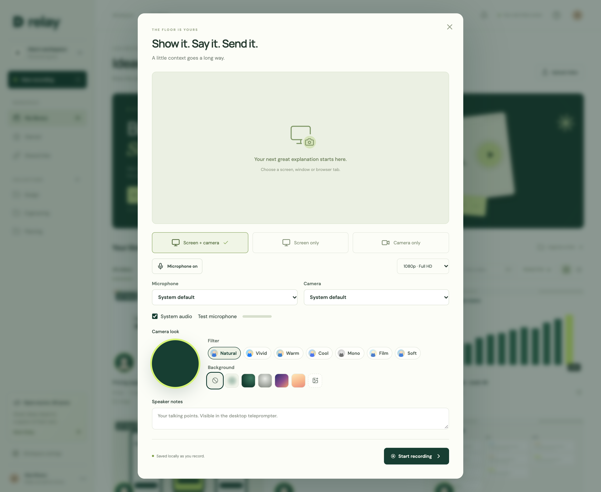
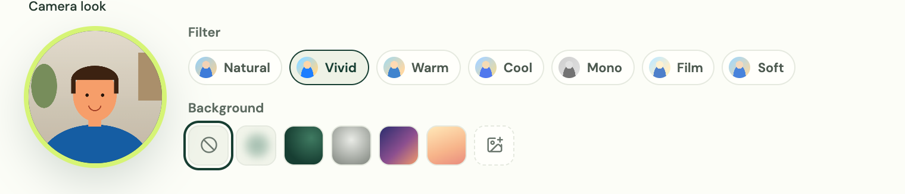
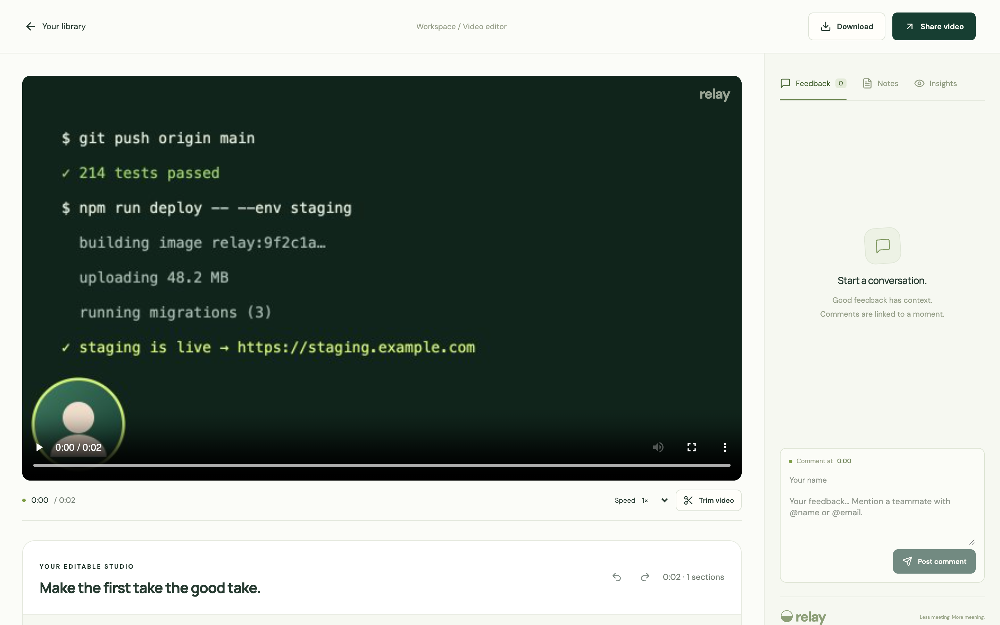
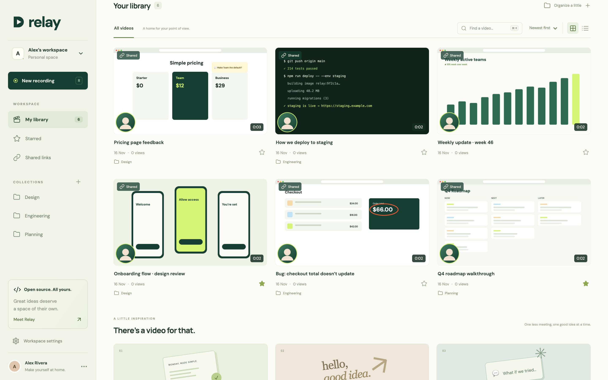

<p align="center">
  
</p>

<h3 align="center">The open-source screen recorder for Mac.<br>Record your screen, camera and voice. Edit by deleting words. Share one link.</h3>

<p align="center">
  <a href="https://github.com/saassteve/relay-studio/releases/latest/download/Relay-mac-arm64.dmg"></a>
  &nbsp;
  <a href="https://github.com/saassteve/relay-studio/releases/latest/download/Relay-mac-x64.dmg"></a>
</p>

<p align="center">
  Free · No account · macOS 13 or later ·
  <a href="https://github.com/saassteve/relay-studio/releases/latest">All downloads</a>
</p>

<p align="center">
  <a href="https://github.com/saassteve/relay-studio/releases/latest"></a>
  <a href="LICENSE"></a>
  <a href="https://github.com/saassteve/relay-studio/actions/workflows/checks.yml"></a>
</p>

---

## Install in a minute

**Fastest:** paste this into Terminal. It picks the right version for your Mac, checks the download, installs Relay and opens it.

```sh
curl -fsSL https://raw.githubusercontent.com/saassteve/relay-studio/main/install.sh | sh
```

<details>
<summary><b>Or download the app yourself</b></summary>

1. **Download** the version for your Mac using the buttons above. Not sure which? Open the **Apple menu → About This Mac**. "Chip: Apple M…" means Apple Silicon; "Processor: Intel" means Intel.
2. **Open the DMG** and drag **Relay** into **Applications**.
3. **Open Relay.** Relay isn't notarized by Apple yet, so the first time macOS says it can't check the app:
   - Click **Done**.
   - Open **System Settings → Privacy & Security**, scroll down and click **Open Anyway** next to "Relay was blocked".
   - Click **Open Anyway** again and enter your password. You only do this once.

</details>

On first launch Relay downloads its video engine (about 30 MB, once). Then a one-minute setup walks you through permissions, a camera and mic check, and your preferences.

<details>
<summary><b>Windows or Linux?</b></summary>

The app is Mac-only for now. Everywhere else, [run Relay from source](#run-from-source) and use it in your browser, or [self-host it](docs/SELF-HOSTING.md) for your team.
</details>

---

## Videos that look finished

<p align="center">
  
</p>

Every screen recording comes out **framed on a wallpaper** with rounded corners and a soft shadow. No editing needed. Then make it yours:

- **Nine wallpapers**, plus padding, corner and shadow controls.
- **Four layouts:** camera bubble, side by side, screen only, or just you. Change layout partway through and Relay blends from one to the next.
- **Auto-zoom** follows what you point at, and only the screen zooms.

## What you get

<table>
<tr>
<td width="50%" valign="top">

### Record without limits
No time cap, no video quota, 4K included. Record screen + camera, screen only, or camera only, from a display, a window or any region you drag out.

A draggable **camera bubble**, a **3-2-1 countdown**, **speaker notes** in the floating controls, and an on-screen **marker** you can draw with. Relay gets out of the way while you record.

</td>
<td width="50%"></td>
</tr>
<tr>
<td width="50%"></td>
<td width="50%" valign="top">

### Look your best
Seven **camera filters** and **virtual backgrounds**: blur, four scenes, or your own picture. People are cut out by an AI model that runs on your Mac. The bubble you see is exactly what gets recorded.

</td>
</tr>
<tr>
<td width="50%" valign="top">

### Auto-zoom to what matters
Point at something and pause. Relay notices and zooms in smoothly, then eases back out. It zooms the screen only; your camera bubble stays put. Every zoom is an ordinary edit you can move, tweak or delete.

</td>
<td width="50%"></td>
</tr>
<tr>
<td width="50%"></td>
<td width="50%" valign="top">

### Edit like a doc
Transcripts are made **on your Mac**. Delete a word and it's cut from the video. Trim, split, reorder and stitch takes. Add text, arrows, blur and zoom. Remove ums and silences in one go. Every edit is reversible, and your original footage is never touched.

</td>
</tr>
<tr>
<td width="50%" valign="top">

### Share and get feedback
One link always plays your latest version. Add a password or expiry date, or limit it to people you invite. Viewers comment at the exact second, with replies and emoji reactions, and you see who watched and how far.

</td>
<td width="50%"></td>
</tr>
</table>

**Never lose a take.** Every recording is saved to disk each second while you record, so a crash can't cost you footage. Unfinished takes come back the next time you open Relay.

## Shortcuts

| | |
| --- | --- |
| <kbd>⌥</kbd> <kbd>⇧</kbd> <kbd>R</kbd> | Start recording from anywhere. Press again to finish |
| <kbd>⌥</kbd> <kbd>⇧</kbd> <kbd>P</kbd> | Pause and resume |
| <kbd>⌥</kbd> <kbd>⇧</kbd> <kbd>D</kbd> | Draw on screen |
| <kbd>⌥</kbd> <kbd>⇧</kbd> <kbd>C</kbd> | Discard the take |

Relay also lives in your menu bar, with the timer and controls one click away.

## How Relay compares

| | Relay | Loom |
| --- | :---: | :---: |
| Price | Free and open source | Free tier, then from $18/user/month |
| Recording length | Unlimited | 5 minutes on the free plan |
| 4K recording | ✓ | Paid plans |
| Where videos live | Your Mac or your server | Loom's cloud |
| Camera filters and virtual backgrounds | ✓ on-device | ✓ |
| Wallpapers, rounded frames and shadows | ✓ | — |
| Switch layouts mid-video | ✓ | — |
| Auto-zoom to key moments | ✓ | — |
| Edit by deleting words | ✓ | ✓ |
| Transcripts and summaries | ✓ on-device | Cloud AI, paid plan |
| Filler and silence removal | ✓ | Paid plan |
| Passwords and link expiry | ✓ | Paid plan |
| Viewer analytics | ✓ | Engagement data on paid plans |
| Stop and discard shortcuts on Mac | ✓ | — |
| Export projects with original tracks | ✓ | — |
| Self-host for a team | ✓ | — |
| Meeting recorder and calendar | Not yet | ✓ |
| Slack, Jira and Notion apps | Not yet | ✓ |

## Privacy

Nothing leaves your Mac unless you share it. The Mac app needs no sign-up, sends no telemetry and uses no cloud AI. On its own it only ever downloads the video engine, once, and open-source AI models the first time you use transcription, summaries or backgrounds.

Share links from the Mac app point to your own computer, so they work while Relay is running. For links that work for anyone, anywhere, [host Relay on a server](docs/SELF-HOSTING.md) and point the app at it.

## Good to know

- On-device transcription and summaries need an Apple Silicon Mac. On Intel Macs everything else works, and you can import captions.
- The app isn't notarized by Apple yet, hence the one-time "Open Anyway" step. The Terminal installer avoids it.

## Run from source

Requires Node 24.15+ and npm.

```sh
git clone https://github.com/saassteve/relay-studio.git
cd relay-studio
npm ci
npm run dev          # web app at http://127.0.0.1:5173
npm run desktop      # Mac app from source
npm run desktop:dist # build the DMGs into release/
```

Tests: `npm test` (API and rendering), `npm run test:e2e` (Chrome), `npm run test:desktop` (Electron). Self-hosting, settings and integrations are in [docs/SELF-HOSTING.md](docs/SELF-HOSTING.md).

## Contributing

Issues and pull requests are welcome. See [CONTRIBUTING.md](CONTRIBUTING.md). The "Not yet" rows above are a good place to start. Found a security problem? Please report it privately ([SECURITY.md](SECURITY.md)).

## License

Relay is [MIT licensed](LICENSE). The Mac app downloads FFmpeg (GPLv3+) separately on first launch; see [third-party notices](THIRD_PARTY_NOTICES.md).
