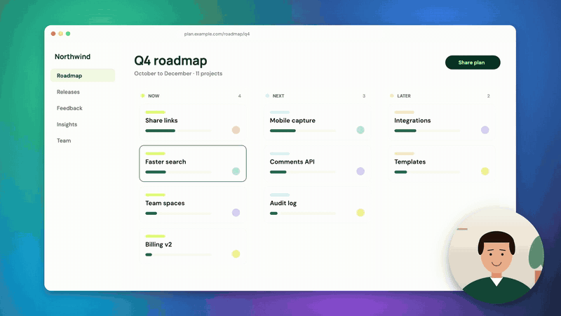
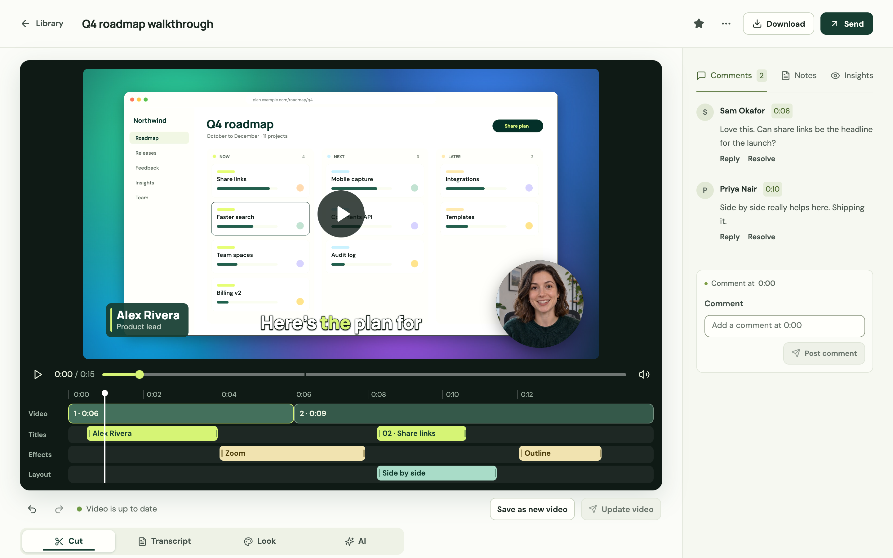
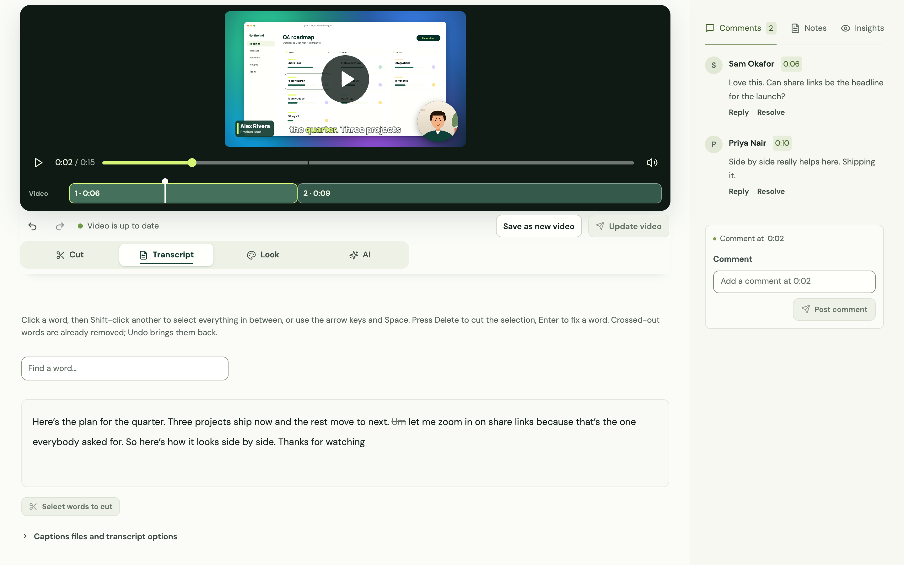
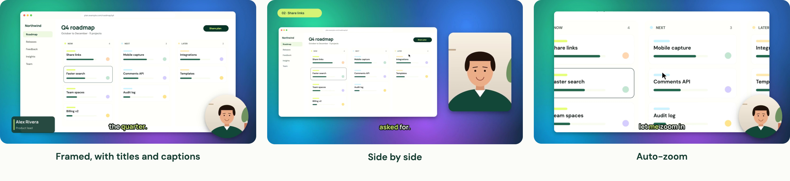
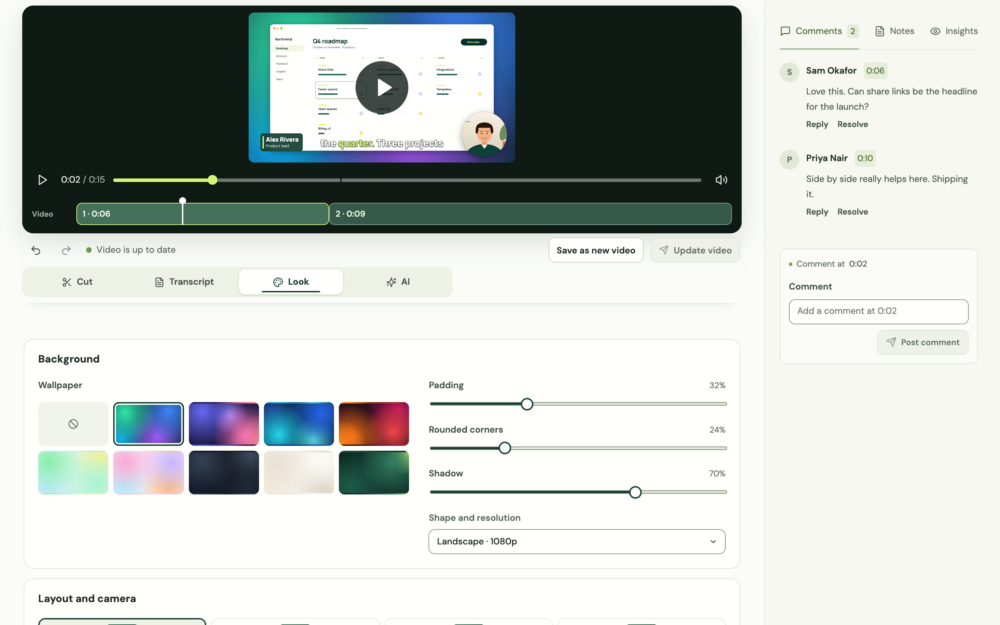
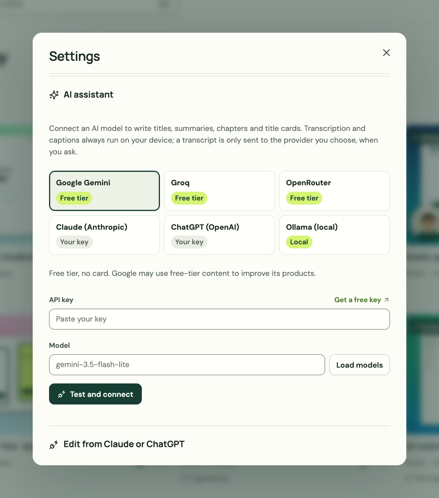
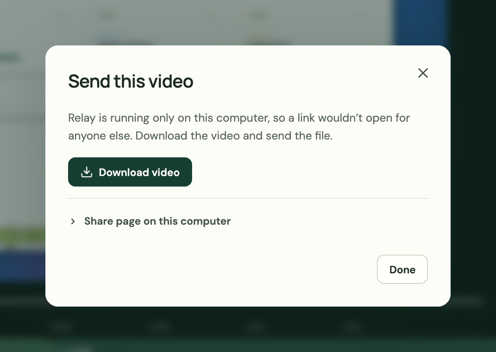
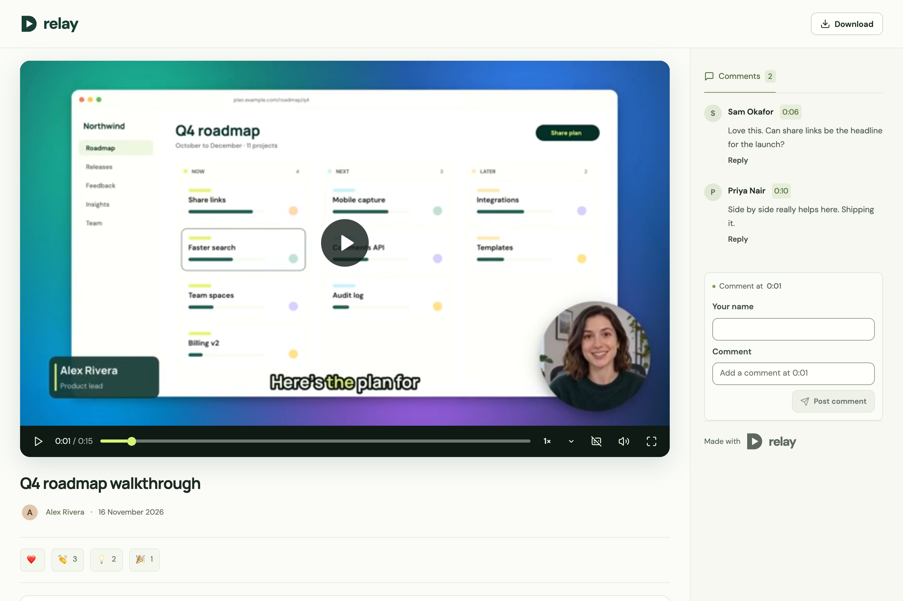
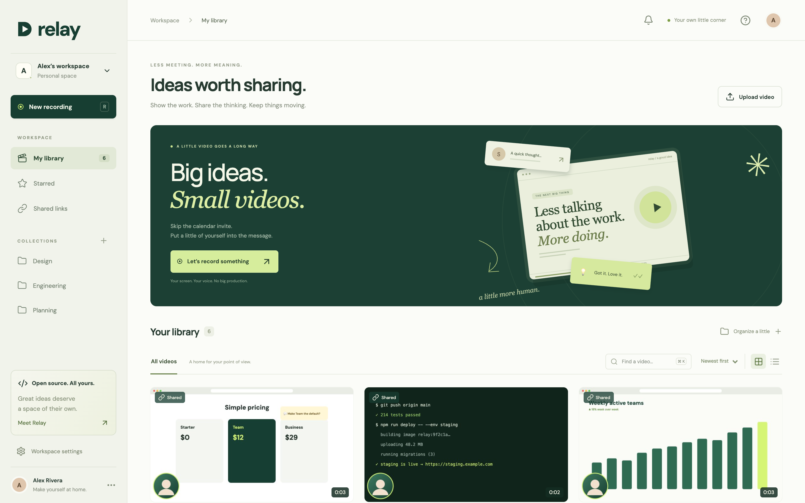

<p align="center">
  
</p>

<h3 align="center">The open-source screen recorder and editor for Mac.<br>Record your screen, camera and voice. Edit like a doc. Keep every video.</h3>

<p align="center">
  <a href="https://github.com/saassteve/relay-studio/releases/latest/download/Relay-mac-arm64.dmg"></a>
  &nbsp;
  <a href="https://github.com/saassteve/relay-studio/releases/latest/download/Relay-mac-x64.dmg"></a>
</p>

<p align="center">
  Free · No account · No time limits · macOS 13 or later ·
  <a href="https://github.com/saassteve/relay-studio/releases/latest">All downloads</a>
</p>

<p align="center">
  <a href="https://github.com/saassteve/relay-studio/releases/latest"></a>
  <a href="LICENSE"></a>
  <a href="https://github.com/saassteve/relay-studio/actions/workflows/checks.yml"></a>
</p>

<p align="center">
  Built by <a href="https://brep.ai/?ref=relay-github">brep</a>
</p>

<p align="center">
  <a href="#install-in-a-minute">Install</a> ·
  <a href="#take-the-tour">Tour</a> ·
  <a href="#how-relay-compares">Compare</a> ·
  <a href="#privacy">Privacy</a> ·
  <a href="docs/SELF-HOSTING.md">Self-host</a> ·
  <a href="#run-from-source">Build it</a>
</p>

---

<p align="center">
  
</p>

<p align="center"><i>A 15-second Relay export. The framing, name title, captions, zoom and layout change are all Relay.<br>No other editor touched it.</i></p>

## Why Relay

- **It's yours.** Recordings live on your Mac or your own server. No sign-up, no telemetry, no upload you didn't ask for.
- **It looks finished.** Wallpapers, rounded frames, auto-zoom, captions and titles come built in, so a first take is ready to send.
- **It edits like a doc.** Delete a word and it's cut from the video. Everything can be undone and your original footage is never touched.
- **It's free.** No time cap, no video quota, 4K included, MIT licensed.

## Install in a minute

**Fastest:** paste this into Terminal. It picks the right version for your Mac, checks the download, installs Relay and opens it.

```sh
curl -fsSL https://raw.githubusercontent.com/saassteve/relay-studio/main/install.sh | sh
```

<details>
<summary><b>Or download the app yourself</b></summary>

1. **Download** the version for your Mac using the buttons above. Not sure which? Open the **Apple menu → About This Mac**. "Chip: Apple M…" means Apple Silicon; "Processor: Intel" means Intel.
2. **Open the DMG** and drag **Relay** into **Applications**.
3. **Open Relay.** It is signed and notarized by Apple, so it opens like any other app. The first time, macOS asks you to confirm that you want to open an app downloaded from the internet.

</details>

On first launch Relay downloads its video engine (about 30 MB, once). Then a one-minute setup walks you through permissions, a camera and mic check, and your preferences.

<details>
<summary><b>What first launch looks like</b></summary>
<br>

</details>

<details>
<summary><b>Windows or Linux?</b></summary>

The app is Mac-only for now. Everywhere else, [run Relay from source](#run-from-source) and use it in your browser, or [self-host it](docs/SELF-HOSTING.md) for your team.
</details>

## Take the tour

### An editor with a real timeline

<p align="center">
  
</p>

The preview shows exactly what your viewers will get, as you edit. Underneath, a timeline lays out your sections, titles, zooms and layout changes as bars you can drag to move or stretch. Pause and drag text, arrows, boxes, blurs and the camera bubble right in the picture.

Edits save themselves. One button, **Update video**, puts them into the file you share, and <kbd>⌘</kbd> <kbd>Z</kbd> takes back anything.

### Edit by deleting words

<p align="center">
  
</p>

Relay transcribes your video **on your Mac**. Click a word to jump to it, select a few and press <kbd>Delete</kbd> to cut them from the video. Remove every "um" and long pause in one go, fix a misheard word, or trim, split and reorder sections by hand.

### Videos that look finished

<p align="center">
  
</p>

<table>
<tr>
<td width="50%" valign="top">

**Framed by default.** Every screen recording comes out on a wallpaper with rounded corners and a soft shadow. Pick from nine wallpapers and tune padding, corners and shadow.

**Four layouts.** Camera bubble, side by side, screen only, or just you. Change layout partway through and Relay blends from one to the next.

**Auto-zoom.** Point at something and pause. Relay zooms in smoothly and eases back out. Only the screen zooms; your camera stays put.

</td>
<td width="50%" valign="top">

**Captions.** Burned-in captions in four styles, including word-by-word highlighting.

**Titles.** Title cards, name-and-role bars and chapter labels that match the rest of the video.

**Callouts.** Text, arrows, boxes and blur for the parts people shouldn't miss, or shouldn't see.

</td>
</tr>
</table>

<p align="center">
  
</p>

### Bring your own AI, or none at all

<table>
<tr>
<td width="46%"></td>
<td width="54%" valign="top">

Transcripts and basic summaries run on your Mac with no account. For better writing, connect a provider you choose, with your own key:

- **Free to start:** Google Gemini, Groq and OpenRouter have free tiers.
- **Fully local:** Ollama runs on your own machine.
- **Or your own:** Claude (Anthropic) and ChatGPT (OpenAI).

Relay then drafts a title, description, title card and chapters, and can turn a video into a message, a step-by-step guide, a bug report, a pull request description or a prompt for a coding agent.

It asks before any transcript leaves your computer.

</td>
</tr>
</table>

**Let your assistant do the editing.** Relay has an [MCP](https://modelcontextprotocol.io) connector, so Claude, ChatGPT and other assistants can edit by chat: "cut the first 20 seconds, add a title card and switch to side by side for the demo". Every change they make is a draft you can undo.

### Record without the fuss

<table>
<tr>
<td width="56%"></td>
<td width="44%" valign="top">

Screen and camera, screen only, or camera only, from a display, a window or any region you drag out. No time cap, 4K included.

- A draggable **camera bubble** with seven **filters** and **virtual backgrounds**: blur, four scenes or your own picture. People are cut out by a model that runs on your Mac.
- A **3-2-1 countdown**, **speaker notes** in the floating controls, and a **marker** for drawing on screen.
- **Never lose a take.** Recordings are saved to disk every second, so a crash can't cost you footage.

</td>
</tr>
</table>

### Send it your way

<table>
<tr>
<td width="54%" valign="top">

On your Mac, **Send** gives you the finished file, named after your video, ready to drop into Slack, email or anywhere else.

Host Relay on a server and the same button becomes **Share**: one link that always plays your latest version, with passwords, expiry dates and invite-only access.

Viewers get a clean player with speed control and captions. They can comment at the exact second, reply and react, and you see who watched and how far.

</td>
<td width="46%"></td>
</tr>
</table>

<p align="center">
  
</p>

### A library that stays out of your way

<p align="center">
  
</p>

Search everything with <kbd>⌘</kbd> <kbd>K</kbd>, star what matters and group videos into collections. Unfinished takes come back the next time you open Relay.

## Shortcuts

| | |
| --- | --- |
| <kbd>⌥</kbd> <kbd>⇧</kbd> <kbd>R</kbd> | Start recording from anywhere. Press again to finish |
| <kbd>⌥</kbd> <kbd>⇧</kbd> <kbd>P</kbd> | Pause and resume |
| <kbd>⌥</kbd> <kbd>⇧</kbd> <kbd>D</kbd> | Draw on screen |
| <kbd>⌥</kbd> <kbd>⇧</kbd> <kbd>C</kbd> | Discard the take |
| <kbd>⌘</kbd> <kbd>K</kbd> | Search your library |
| <kbd>⌘</kbd> <kbd>Z</kbd> | Undo an edit |
| <kbd>Space</kbd> | Play and pause |

Relay also lives in your menu bar, with the timer and controls one click away.

## How Relay compares

| | Relay | Loom |
| --- | :---: | :---: |
| Price | Free and open source | Free tier, then from $18/user/month |
| Recording length | Unlimited | 5 minutes on the free plan |
| 4K recording | ✓ | Paid plans |
| Where videos live | Your Mac or your server | Loom's cloud |
| Camera filters and virtual backgrounds | ✓ on-device | ✓ |
| Wallpapers, rounded frames and shadows | ✓ | — |
| Switch layouts mid-video | ✓ | — |
| Auto-zoom to key moments | ✓ | — |
| Edit by deleting words | ✓ | ✓ |
| Transcripts and summaries | ✓ on-device | Cloud AI, paid plan |
| Bring your own AI provider | ✓ | — |
| Filler and silence removal | ✓ | Paid plan |
| Passwords and link expiry | ✓ | Paid plan |
| Viewer analytics | ✓ | Engagement data on paid plans |
| Stop and discard shortcuts on Mac | ✓ | — |
| Export projects with original tracks | ✓ | — |
| Self-host for a team | ✓ | — |
| Meeting recorder and calendar | Not yet | ✓ |
| Slack, Jira and Notion apps | Not yet | ✓ |

## Privacy

Nothing leaves your Mac unless you send it. The Mac app needs no sign-up and sends no telemetry. On its own it only ever downloads the video engine, once, and open-source AI models the first time you use transcription, summaries or backgrounds.

AI providers are off until you connect one, and Relay asks before a transcript leaves your computer.

Share links from the Mac app point to your own computer, so they work while Relay is running. For links that work for anyone, anywhere, [host Relay on a server](docs/SELF-HOSTING.md) and point the app at it.

## Good to know

- On-device transcription and summaries need an Apple Silicon Mac. On Intel Macs everything else works, and you can import captions.
- The app is signed with a Developer ID and notarized by Apple. `npm run desktop:release` does the same for your own builds.

## Run from source

Requires Node 24.15+ and npm.

```sh
git clone https://github.com/saassteve/relay-studio.git
cd relay-studio
npm ci
npm run dev          # web app at http://127.0.0.1:5173
npm run desktop      # Mac app from source
npm run desktop:dist # build the DMGs into release/
```

Tests: `npm test` (API and rendering), `npm run test:e2e` (Chrome), `npm run test:desktop` (Electron). Self-hosting, settings and integrations are in [docs/SELF-HOSTING.md](docs/SELF-HOSTING.md).

Every image on this page is made by `node scripts/screenshots.mjs`, which builds demo recordings and renders them with Relay itself. The presenter is an AI-generated stand-in, not a real person.

## Who makes Relay

Relay is built and maintained by [brep](https://brep.ai/?ref=relay-github), an AI consulting and engineering practice for small and mid-sized businesses. If you want software or AI agents built to this standard inside your own business, [talk to us](https://brep.ai/?ref=relay-github).

## Contributing

Issues and pull requests are welcome. See [CONTRIBUTING.md](CONTRIBUTING.md). The "Not yet" rows above are a good place to start. Found a security problem? Please report it privately ([SECURITY.md](SECURITY.md)).

## License

Relay is [MIT licensed](LICENSE). The Mac app downloads FFmpeg (GPLv3+) separately on first launch; see [third-party notices](THIRD_PARTY_NOTICES.md).
