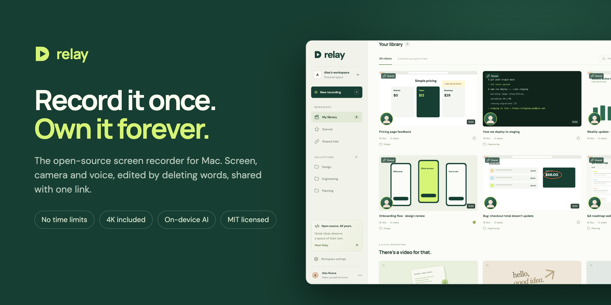
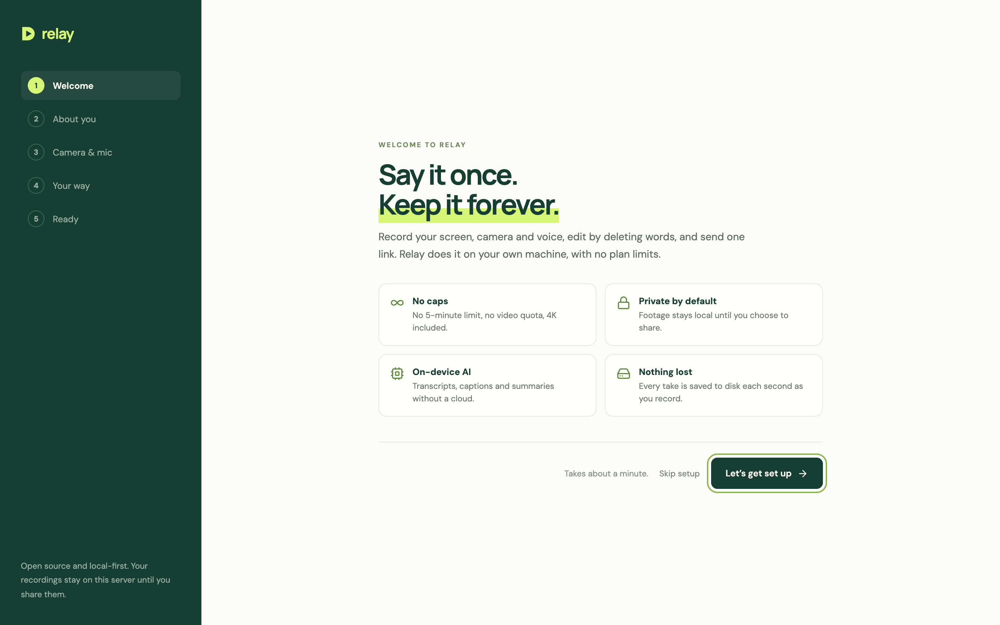

<p align="center">
  
</p>

<h3 align="center">The open-source screen recorder for Mac.<br>Record your screen, camera and voice. Edit by deleting words. Share one link.</h3>

<p align="center">
  <a href="https://github.com/saassteve/relay-studio/releases/latest/download/Relay-mac-arm64.dmg"><b>⬇&nbsp; Download for Mac</b></a>
  &nbsp;·&nbsp; Apple Silicon · macOS 12+ · Free, no account
</p>

<p align="center">
  <a href="https://github.com/saassteve/relay-studio/releases/latest"></a>
  <a href="LICENSE"></a>
  <a href="https://github.com/saassteve/relay-studio/actions/workflows/checks.yml"></a>
</p>

---

## Install

**1. Download** [**Relay-mac-arm64.dmg**](https://github.com/saassteve/relay-studio/releases/latest/download/Relay-mac-arm64.dmg), open it, and drag **Relay** into **Applications**.

**2. Open Relay.** Relay isn't notarized by Apple yet, so the first time macOS says it can't verify the app:

1. Click **Done** in that message.
2. Open **System Settings → Privacy & Security**, scroll down, and click **Open Anyway** next to "Relay was blocked".
3. Confirm with **Open Anyway** and your password. You only do this once.

**3. That's it.** On first launch Relay downloads its video engine (28 MB, once), then walks you through a one-minute setup: permissions, camera and mic check, and your preferences.

<details>
<summary><b>Prefer the terminal?</b> Install with one line, no security prompts.</summary>

```sh
curl -fsSL https://raw.githubusercontent.com/saassteve/relay-studio/main/install.sh | sh
```

It downloads the latest release, copies Relay to `/Applications`, clears the download flag and opens the app. [Read the script](install.sh) first if you like; it's 40 lines.
</details>

<details>
<summary><b>Intel Mac, Windows or Linux?</b></summary>

The download is for Apple Silicon Macs (M1 and later). Everywhere else, [run Relay from source](#run-from-source) and use it in your browser, or [self-host it](docs/SELF-HOSTING.md) for your team.
</details>

---

## What you get

<table>
<tr>
<td width="50%" valign="top">

### Record without limits
No 5-minute cap, no video quota, 4K included. Screen + camera, screen only, or camera only, from a display, a window or any region you drag out.

A draggable **camera bubble**, a **3-2-1 countdown**, **speaker notes** in the floating controls, and an on-screen **marker** you can draw with. Relay gets out of the way while you record.

</td>
<td width="50%"></td>
</tr>
<tr>
<td width="50%"></td>
<td width="50%" valign="top">

### Edit like a doc
Transcripts are generated **on your Mac**. Delete a word and it's cut from the video. Trim, split, reorder and stitch takes, add text, arrows, blur and zoom, and remove ums and silences with one click.

Every edit is reversible, and your original footage is never touched.

</td>
</tr>
<tr>
<td width="50%" valign="top">

### Share and get feedback
One link plays your latest version. Add a password, an expiry date, or limit it to invited people. Viewers leave comments at the exact second, with replies and emoji reactions. You see who watched, and how far.

</td>
<td width="50%"></td>
</tr>
<tr>
<td width="50%"></td>
<td width="50%" valign="top">

### Yours, start to finish
Recordings live on your Mac, saved to disk every second as you record, so a crash never costs you a take. AI runs locally. Export any project with its original tracks, or move it to a server you host yourself.

</td>
</tr>
</table>

## Shortcuts

| | |
| --- | --- |
| <kbd>⌘</kbd> <kbd>⇧</kbd> <kbd>R</kbd> | Start recording from anywhere. Press again to finish |
| <kbd>⌥</kbd> <kbd>⇧</kbd> <kbd>P</kbd> | Pause and resume |
| <kbd>⌥</kbd> <kbd>⇧</kbd> <kbd>D</kbd> | Draw on screen |
| <kbd>⌥</kbd> <kbd>⇧</kbd> <kbd>C</kbd> | Discard the take |

Relay also lives in your menu bar, with the timer and controls one click away.

## How Relay compares

| | Relay | Loom |
| --- | :---: | :---: |
| Price | Free and open source | Free tier, then from $18/user/month |
| Recording length | Unlimited | 5 minutes on the free plan |
| 4K recording | Included | Paid plans |
| Where videos live | Your Mac or your server | Loom's cloud |
| Transcripts and summaries | On your device | Cloud AI, paid plan |
| Edit by deleting words | ✓ | ✓ |
| Filler and silence removal | ✓ | Paid plan |
| Passwords and link expiry | ✓ | Paid plan |
| Viewer analytics | ✓ | Engagement data on paid plans |
| Stop and discard shortcuts on Mac | ✓ | — |
| Export project with original tracks | ✓ | — |
| Self-host for a team | ✓ | — |
| Camera filters and virtual backgrounds | Not yet | ✓ |
| Meeting recorder and calendar | Not yet | ✓ |
| Slack, Jira and Notion apps | Not yet | ✓ |

## Privacy

Nothing leaves your Mac unless you share it. The Mac app needs no sign-up, sends no telemetry and uses no cloud AI. The only network requests the Mac app makes on its own are the one-time download of the video engine and of the open-source AI models the first time you transcribe or summarize.

Sharing links from the Mac app point to your own computer (`127.0.0.1`), so they work while Relay is running. For links that work for anyone, anywhere, [host Relay on a server](docs/SELF-HOSTING.md) and point the app at it.

## Run from source

Requires Node 24.15+ and npm.

```sh
git clone https://github.com/saassteve/relay-studio.git
cd relay-studio
npm ci
npm run dev          # web app at http://127.0.0.1:5173
npm run desktop      # Mac app from source
npm run desktop:dist # build Relay-mac-arm64.dmg in release/
```

Tests: `npm test` (API), `npm run test:e2e` (Chrome), `npm run test:desktop` (Electron). More in [docs/SELF-HOSTING.md](docs/SELF-HOSTING.md).

## Contributing

Issues and pull requests are welcome. If you're picking something up, the "Not yet" rows in the comparison are a good place to start.

## License

Relay is [MIT licensed](LICENSE). The Mac app downloads FFmpeg (GPLv3+) separately on first launch; see [third-party notices](THIRD_PARTY_NOTICES.md).
